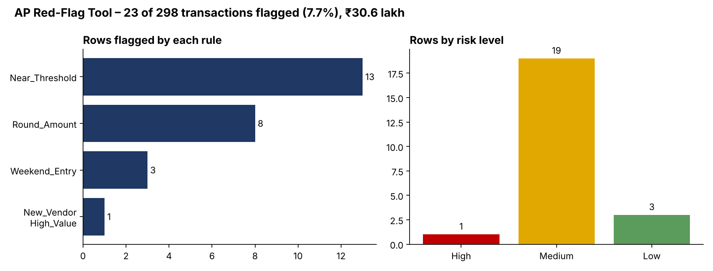

# AP Red-Flag Tool – Low-code fraud screening with AI-assisted review

**Practice project on synthetic data** (fictitious company, vendors and users).

## Problem
Accounts-payable teams need a fast, transparent way to spot payments that deserve a closer look before spending time (or AI) on them.

## What I built
An Excel tool (no code, formulas only) that screens 298 vendor payments with four rules, scores each row and builds a prioritised review queue for AI-assisted, human-verified triage.

| Rule | Logic | Weight |
|---|---|---|
| Near_Threshold | 90% to under 100% of the poster's approval limit | 25 |
| Round_Amount | ≥ ₹50,000 and a multiple of ₹5,000 | 20 |
| Weekend_Entry | Posted Saturday/Sunday | 15 |
| New_Vendor_High_Value | Vendor ≤ 90 days old and amount ≥ ₹1,00,000 | 40 |

All thresholds and weights are editable on the Settings sheet.

## Results
- 23 of 298 rows flagged (7.7%), worth ₹30.6 lakh
- Highest risk: ₹9,75,000 paid to a vendor created 2 days earlier
- Tested against 20 seeded anomalies: **15 caught, 5 missed, 8 false positives**
- Misses (duplicate payment, reused invoice number, over-limit posting) point to the next rules to add

## Files
| # | File | What it is |
|---|---|---|
| 02 | AP_RedFlag_Tool.xlsx | The tool: Summary, Settings, Review_Queue, Transactions |
| 03 | AP_Ledger_Transactions.csv | Raw dataset |
| 04 | Findings_Memo.pdf | Findings, validation, limitations, next steps |
| 05–07 | Chart_*.png | Flag summary, review queue, validation |
| 08 | Answer_Key_Validation.xlsx | List of seeded anomalies used for testing |

## Tools
Microsoft Excel (INDEX/MATCH, IF/AND, MOD, WEEKDAY, conditional formatting) · AI assistant for triage, with documented human review

*A flag is a reason to review, not proof of fraud.*
